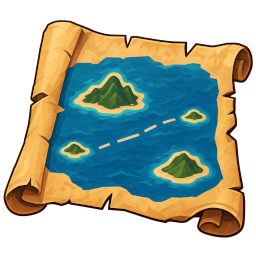

<p align="center">
  
</p>

# Open Waters

Valheim 1.0.21 mod for BepInEx that reduces the number of islands and increases open ocean. It keeps vanilla coastlines by lowering terrain instead of removing land.

[](https://github.com/Mkbewe/valheim-open-waters/releases)

**Start here:** [User Guide](https://github.com/Mkbewe/valheim-open-waters/blob/main/docs/USER_GUIDE.md) - installation, panel controls, preview, configuration, and experimental manual multiplayer notes. Multiplayer is not officially supported.

## Facts

- Version: `0.1.0`
- Plugin GUID: `valheim.openwaters`
- Assembly / namespace: `OpenWaters`
- Target: `netstandard2.1`
- Game: Valheim 1.0.21, BepInEx 5.4.x
- License: MIT
- Distribution: not published

## Features

### Generation

- Island presets: `Few`, `Medium`, `Vanilla` (default).
- Few and Medium re-implement the vanilla noise stack with configurable frequency, detail damping, peak protection and a binary-searched height offset. Defaults: Few `0.27`, Medium `0.50` of vanilla land.
- Few compresses high terrain with `MountainCompressionStart` and `MountainCompressionFactor`.
- `Vanilla` changes nothing unless `Remove mountains` or `Max biomes` is set.
- Dragonqueen altar minimum altitude is 40 m when Few or Medium is active.

### Starting island

- `IslandAnalysis` samples a 1024Ă‚Ë› grid using `GetHeight > 30`, builds connected components and records area, centre, bounds and biome histograms.
- The starting island is the component at world centre.
- `Remove mountains` (default off): suppresses heights `0.34`–`0.39` on the starting island; also active with Vanilla.
- `Max biomes` (default `Vanilla`): `1` sets the whole starting island to Meadows; `2` keeps native Meadows/BlackForest, keeps a 250 m spawn safe radius and maps other biomes to Meadows/BlackForest. Mountains, Ocean, AshLands and Deep North are skipped.

### New World UI and preview

- Enable toggle, island preset slider, starting-island section (`Remove mountains`, `Max biomes`), `Preview` toggle.
- `Generate preview` renders a 400×400 map from 512² samples, with `Land` / `Biomes` views, biome colours, separate swamp-water colour and spawn marker.
- Preview work is split across frames (16 rows per step). Land and biome textures are cached in memory (up to 8 entries).
- New-world settings are captured on creation and saved as `OpenWaters.settings` in the world save directory. Existing worlds reuse the sidecar; without one the preset is Vanilla.

## Constraints

- World size is fixed; `WorldRadius` is used only for analysis and preview sampling.
- `BiomeLimit` is stored in the sidecar but not applied.
- Settings are local; there is no server-to-client synchronization.
- Calibration has no disk cache; only preview textures are cached.

## Install

1. Install BepInExPack Valheim.
2. Copy `OpenWaters.dll` to `<VALHEIM_DIR>/BepInEx/plugins/OpenWaters/`.
3. Set the Open Waters options on the New World screen.

## Build

The SDK is under `~/.dotnet`; the game directory is set in `Directory.Build.props` (override with `-p:ValheimDir=...`). A successful build copies the DLL to `BepInEx/plugins/OpenWaters/`:

```powershell
& "$env:USERPROFILE\.dotnet\dotnet.exe" build OpenWaters.sln -c Debug
```

Use `-p:SkipPluginCopy=true` when the game is running and the DLL is locked.

To build a release package:

```powershell
.\tooling\build-release.ps1
```

The script validates the version in `manifest.json` and `Plugin.cs`, checks the 256Ă—256 icon, runs the core tests, builds `Release`, and writes `dist/MkbewePP-OpenWaters-<version>.zip`. The package contains the DLL, manifest, icon, README, changelog and license files. It deliberately excludes `valheim.openwaters.cfg` and `OpenWaters.settings`.

## Configuration

`BepInEx/config/valheim.openwaters.cfg`:

| Section | Key | Default |
| --- | --- | --- |
| General | `Enabled` | `true` |
| Few | `LandFraction` | `0.27` |
| Few | `FrequencyScale` | `0.60` |
| Few | `PeakProtection` | `0.20` |
| Few | `DetailDamping` | `0.35` |
| Few | `MountainCompressionStart` / `MountainCompressionFactor` | `0.34` / `0.55` |
| Medium | `LandFraction` | `0.50` |
| Medium | `FrequencyScale` | `0.70` |
| Medium | `PeakProtection` | `0.60` |
| Medium | `DetailDamping` | `0.35` |

`LandFraction` is relative to vanilla land, not a percentage of the world.

## Development

Commit messages follow Conventional Commits (lowercase type/scope/subject, header ≤ 72 characters); Husky `commit-msg` enforces it. Run `npm install` once after cloning. Pull request titles are checked by `.github/workflows/pr-title-check.yml`.

Remaining work: [`docs/TODO.md`](https://github.com/Mkbewe/valheim-open-waters/blob/main/docs/TODO.md).

## License

MIT — see [LICENSE](https://github.com/Mkbewe/valheim-open-waters/blob/main/LICENSE). Third-party credits and runtime dependencies are listed in [THIRD-PARTY-NOTICES.md](https://github.com/Mkbewe/valheim-open-waters/blob/main/THIRD-PARTY-NOTICES.md).
