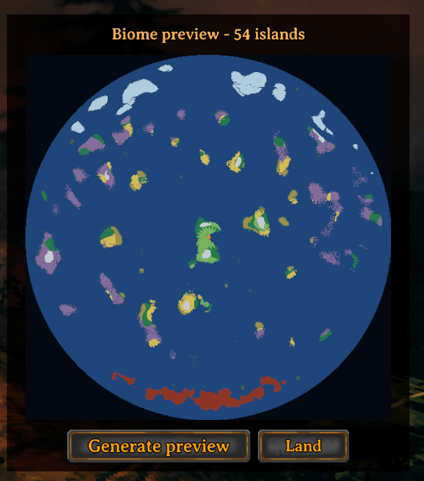
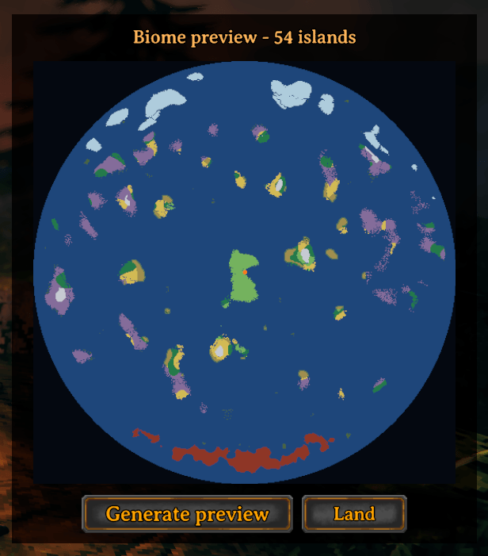
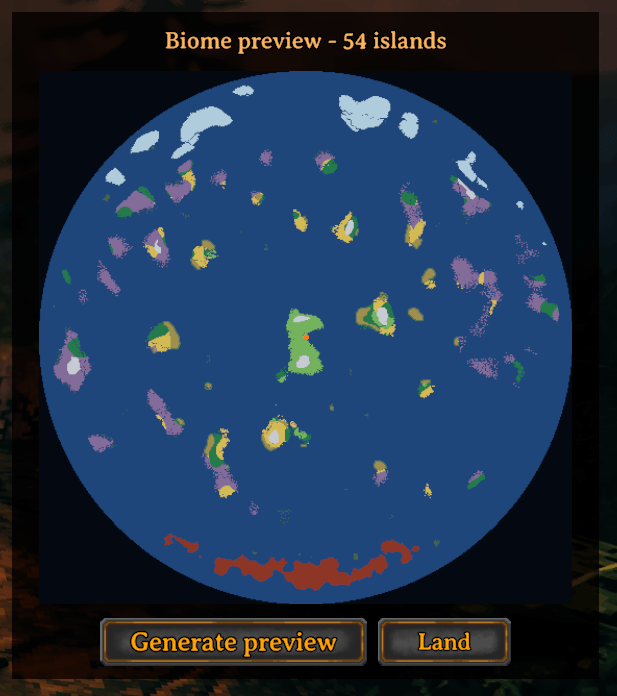
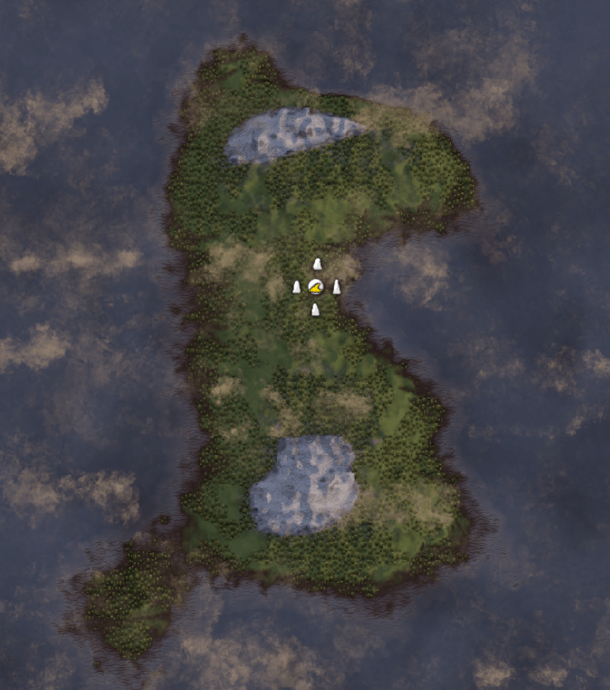
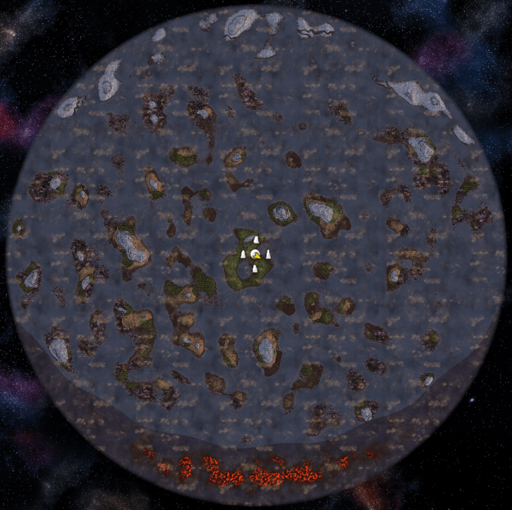
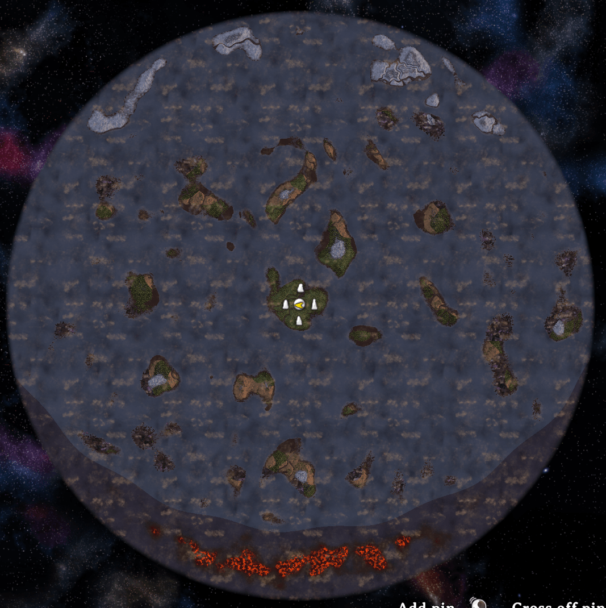

<p align="center">
  
</p>

# Open Waters

**Early alpha:** fewer islands, more open ocean, and a more deliberate starting experience for Valheim 1.0.21.

Open Waters keeps vanilla coastlines by lowering terrain instead of deleting land. It is intended for **single-player**; multiplayer and dedicated servers are not officially supported.

[Read the full User Guide](https://github.com/Mkbewe/valheim-open-waters/blob/main/docs/USER_GUIDE.md) | [Report a problem](https://github.com/Mkbewe/valheim-open-waters/issues)

## Features

- **Island presets:** `Few`, `Medium`, and `Vanilla`.
- **Starting island options:** remove high mountains and limit the number of biomes.
- **Map preview:** compare the seed and settings before creating the world.
- **Per-world settings:** a sidecar stores the settings used when the world was created.

Few targets about 27% of vanilla land; Medium about 50%. These values are relative to the same seed in vanilla, not the whole map.

## Preview examples

| Vanilla - land | Vanilla - biomes |
| --- | --- |
|  |  |
| More land and vanilla coastlines. | Vanilla biome distribution. |

| Medium - land | Medium - biomes |
| --- | --- |
|  |  |
| About 50% of vanilla land. | Biome colours with the Medium preset. |

## Starting island options

| Few - vanilla biomes | Few - Remove mountains |
| --- | --- |
|  |  |
| Starting island keeps its normal biomes. | High peaks on the starting island are suppressed. |

| Few - Max biomes: 1 | Few - Max biomes: 1, mountains kept |
| --- | --- |
|  |  |
| Counted biomes become Meadows. | Biome limit applies, but mountain peaks remain. |

## Generated world

| Few world map | Starting island close-up |
| --- | --- |
|  |  |
| Ocean-heavy world with fewer islands. | Close-up of the starting island. |

| Generated world 1 | Generated world 2 |
| --- | --- |
|  |  |
| Example generated world. | Another generated world example. |

## Installation

### Thunderstore / r2modman

1. Install **BepInExPack Valheim** if it is not already installed.
2. Install **Open Waters** from Thunderstore or r2modman.
3. Start the game through **Start modded**.

### Manual installation

1. Install BepInExPack Valheim.
2. Copy `OpenWaters.dll` to:
   ```text
   <VALHEIM_DIR>/BepInEx/plugins/OpenWaters/
   ```
3. Set the Open Waters options on the New World screen.

## Configuration

The config file is created at:

```text
BepInEx/config/valheim.openwaters.cfg
```

| Section | Key | Default |
| --- | --- | --- |
| General | `Enabled` | `true` |
| Few | `LandFraction` | `0.27` |
| Few | `FrequencyScale` | `0.60` |
| Few | `PeakProtection` | `0.20` |
| Few | `DetailDamping` | `0.35` |
| Few | `MountainCompressionStart` / `MountainCompressionFactor` | `0.34` / `0.55` |
| Medium | `LandFraction` | `0.50` |
| Medium | `FrequencyScale` | `0.70` |
| Medium | `PeakProtection` | `0.60` |
| Medium | `DetailDamping` | `0.35` |

`LandFraction` is relative to vanilla land for the same seed, not a percentage of the world.

## Known limitations

- **Single-player focused.** Settings are local; there is no automatic server-to-client synchronization.
- **Steam Cloud is not synchronized.** `OpenWaters.worldSettings` stays in local storage.
- **Joining a hosted world finds the sidecar by seed.** If several worlds share the same seed, the wrong settings may be selected; a stable world UID is planned.
- **Preview generation can briefly freeze the game.**
- **World size is fixed.** The radius in the sidecar does not resize Valheim's world.
- **The starting island is the only island with biome limits.**

## Links

- [User Guide](https://github.com/Mkbewe/valheim-open-waters/blob/main/docs/USER_GUIDE.md)
- [Source code](https://github.com/Mkbewe/valheim-open-waters)
- [Issues and feedback](https://github.com/Mkbewe/valheim-open-waters/issues)
- [Changelog](https://github.com/Mkbewe/valheim-open-waters/blob/main/CHANGELOG.md)

## AI disclosure

Developed with AI coding assistance (OpenCode) under the author's direction.

## License

MIT. Third-party credits are listed in [THIRD-PARTY-NOTICES.md](https://github.com/Mkbewe/valheim-open-waters/blob/main/THIRD-PARTY-NOTICES.md).
