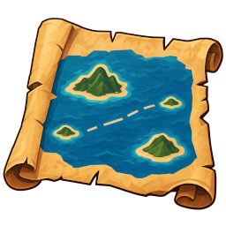
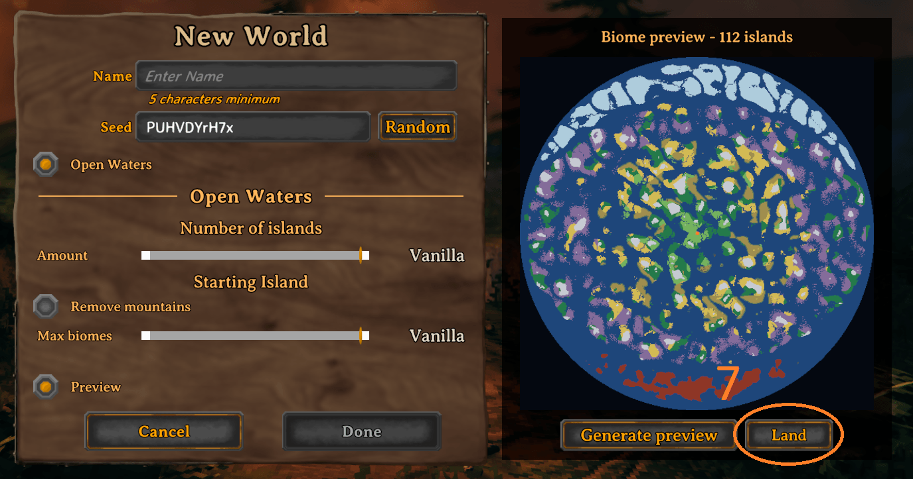
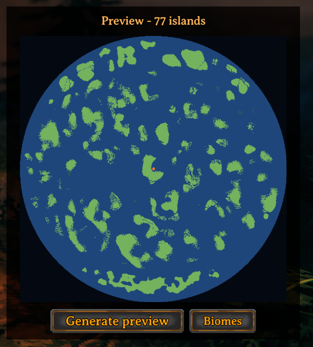
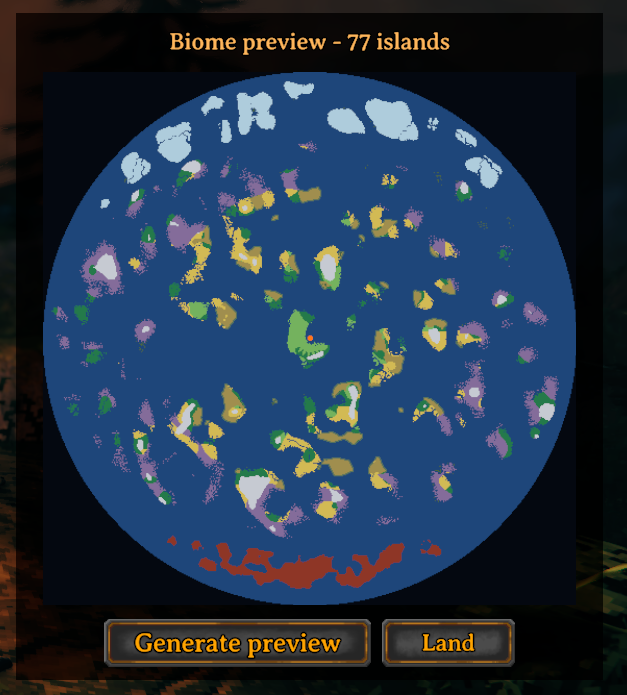
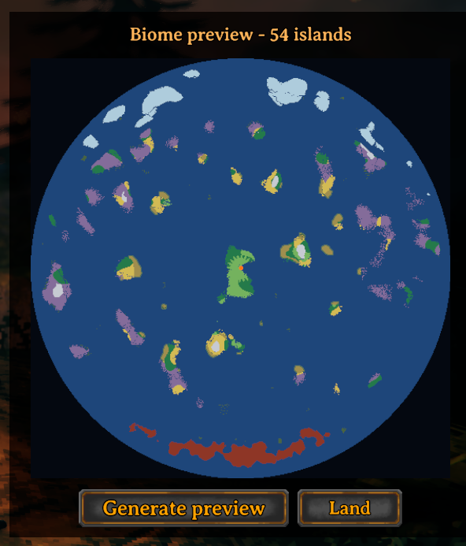
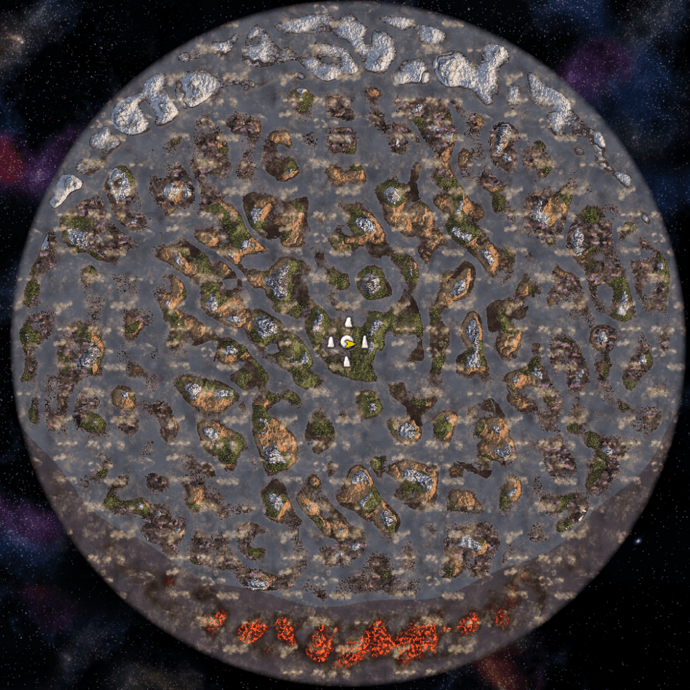

<p align="center">
  
</p>

# Open Waters

**Early alpha:** Open Waters is a **Valheim world generation mod** that creates more open ocean, fewer islands, and a more deliberate sailing experience for Valheim 1.0.21. Preview a world seed before creating it, then adjust the starting island.

Open Waters changes how Valheim generates its terrain, creating more open ocean and fewer islands. It works in **hosted worlds**, with settings synchronized from the host to every client. Dedicated-server support is planned for a future release.

[Read the full User Guide](https://github.com/Mkbewe/valheim-open-waters/blob/main/docs/USER_GUIDE.md) | [Report a problem](https://github.com/Mkbewe/valheim-open-waters/issues)

## What it changes

Open Waters is for players who want more open ocean, fewer islands, more sailing, and a more exploration-focused Valheim world.

- **More open ocean, fewer islands:** choose the `Few` or `Medium` island preset.
- **New-world preview:** compare land and biomes for a seed before creating the world.
- **Starting-island controls:** remove high mountains and limit the biomes on the starting island.
- **Generated terrain:** the mod changes world generation instead of reshaping an existing world.
- **Per-world settings:** `OpenWaters.worldSettings` records the options used when the world was created, plus the vanilla world UID. The file follows the world's save: Steam Cloud worlds keep it in the cloud, local worlds in `worlds_local`; if cloud storage is unavailable, it falls back to local storage.

Few targets about 27% of vanilla land; Medium about 50%. These values are relative to the same seed in vanilla, not the whole map.

## Preview examples

| Vanilla - land | Vanilla - biomes |
| --- | --- |
|  |  |
| Vanilla land distribution. | Vanilla biome distribution. |

| Medium - land | Medium - biomes |
| --- | --- |
|  |  |
| About 50% of vanilla land. | Biome colours with the Medium preset. |

## Starting island options

| Few - vanilla biomes | Few - Remove mountains |
| --- | --- |
|  |  |
| Starting island keeps its normal biomes. | High peaks on the starting island are suppressed. |

| Few - Max biomes: 1 | Few - Max biomes: 1, mountains kept |
| --- | --- |
|  |  |
| Counted biomes become Meadows. | Biome limit applies, but mountain peaks remain. |

## Generated world

| Few world map | Starting island close-up |
| --- | --- |
|  |  |
| Ocean-heavy world with fewer islands. | Close-up of the starting island. |

| Vanilla world | Few world | Medium world |
| --- | --- | --- |
|  |  |  |
| Vanilla world generation. | More open ocean, fewer islands. | Medium islands, about half the vanilla land. |

## Installation

### Thunderstore / r2modman

1. Install **BepInExPack Valheim** if it is not already installed.
2. Install **Open Waters** from Thunderstore or r2modman.
3. Start the game through **Start modded**.

### Manual installation

1. Install BepInExPack Valheim.
2. Copy `OpenWaters.dll` to:
   ```text
   <VALHEIM_DIR>/BepInEx/plugins/OpenWaters/
   ```
3. Set the Open Waters options on the New World screen.

## Configuration

The config file is created at:

```text
BepInEx/config/valheim.openwaters.cfg
```

| Section | Key | Default |
| --- | --- | --- |
| General | `Enabled` | `true` |
| General | `DebugSelfTest` | `false` |
| General | `LocalSidecarFallback` | `false` |
| Few | `LandFraction` | `0.27` |
| Few | `FrequencyScale` | `0.60` |
| Few | `PeakProtection` | `0.20` |
| Few | `DetailDamping` | `0.35` |
| Few | `MountainCompressionStart` / `MountainCompressionFactor` | `0.34` / `0.55` |
| Medium | `LandFraction` | `0.50` |
| Medium | `FrequencyScale` | `0.70` |
| Medium | `PeakProtection` | `0.60` |
| Medium | `DetailDamping` | `0.35` |

`LandFraction` is relative to vanilla land for the same seed, not a percentage of the world. Lower `FrequencyScale` makes larger islands; higher `PeakProtection` keeps more mountains.

`DebugSelfTest` is a diagnostic switch; leave it off for normal play. `LocalSidecarFallback` lets a client use a manually copied settings file when the host does not provide compatible settings; leave it off for normal play.

## FAQ

### How do I get more open ocean and fewer islands in Valheim?

Install Open Waters, start a new world, and choose the `Few` or `Medium` island preset. The mod changes world generation; it does not reshape existing worlds.

### Can I preview a Valheim world before creating it?

Yes. The New World panel renders a land or biome preview for the current seed and settings.

### Does Open Waters work with existing worlds?

It is designed around new worlds. Existing worlds are not reshaped, and you should back up any world before testing generation mods.

### Does Open Waters work in multiplayer?

Yes, in **hosted worlds**. To make it work for everyone:

1. Install the **same Open Waters version** on the host and on every player.
2. Create the world on the host and set the island preset and starting-island options there. These settings are saved with the world.
3. Have everyone join normally. The host sends the world settings to each client during the connection handshake, so all players generate the same terrain. No manual file copying or config matching is needed in normal play.

Players without Open Waters cannot join a world that uses custom settings and will see the game's "wrong version" error. Dedicated servers are not supported yet.

### Is Open Waters compatible with other world-generation mods?

No compatibility is guaranteed. Avoid combining it with other mods that replace Valheim's world generation.

## Known limitations

- **Settings-file matching uses the world UID.** When joining a hosted world the client uses the settings received from the host. If those settings are unavailable, a manually copied settings file is matched by the world UID when `LocalSidecarFallback` is enabled. There is no seed fallback.
- **Settings files from older alpha builds (before 0.2.1) need a UID.** Add `uid=<id>` to `OpenWaters.worldSettings` (the UID is in `BepInEx/LogOutput.log`), or create a new world. Without a UID, the file is ignored and the world generates vanilla terrain.
- **Preview generation can briefly freeze the game.**
- **Starting-island detection is not perfect.** Nearby islands can be modified by mistake, and parts of the starting island cut off by rivers are not modified. `Remove mountains` can also change the starting island's shape.
- **Boss and location placement changes.** Fewer islands change how many locations are generated, including boss altars. Testing confirmed boss locations can spawn, but 100% reliability cannot be guaranteed.
- **Mountain locations can be missing with the Few preset.** Compressed peaks may not reach the height caves need, so some mountain locations, including caves, may not spawn. A fix is planned.
- **The game can be much harder.** Fewer islands mean fewer resources and longer journeys. With `Max biomes: 1`, reaching a Black Forest may require building a raft, and finding boars to tame can be harder on a small starting island.
- **The starting island is the only island with biome limits.**

## Links

- [User Guide](https://github.com/Mkbewe/valheim-open-waters/blob/main/docs/USER_GUIDE.md)
- [Source code](https://github.com/Mkbewe/valheim-open-waters)
- [Issues and feedback](https://github.com/Mkbewe/valheim-open-waters/issues)
- [Changelog](https://github.com/Mkbewe/valheim-open-waters/blob/main/docs/CHANGELOG-STORE.md)

## AI disclosure

Developed with AI coding assistance (OpenCode) under the author's direction.

## License

MIT. Third-party credits are listed in [THIRD-PARTY-NOTICES.md](https://github.com/Mkbewe/valheim-open-waters/blob/main/THIRD-PARTY-NOTICES.md).
