# Open Waters - User Guide

Open Waters is an alpha (0.2.1) world-generation mod for Valheim 1.0.21. It gives you more open ocean and fewer islands. It works in **hosted worlds**: the host sends its generation settings to every client during the handshake, so everyone generates the same world. Dedicated-server support is planned for a future release. See [Hosted worlds](#hosted-worlds).

## Requirements

- Valheim 1.0.21 - this is the version the mod is tested on; older versions may work but are not verified
- BepInEx 5.4.x (BepInExPack Valheim)
- The mod installed on the host and every client of a hosted world that uses custom settings (the host synchronizes settings automatically)

## Installation

Install **Open Waters** from [Thunderstore](https://thunderstore.io/c/valheim/p/MkbewePP/OpenWaters/) or r2modman. For a manual install:

1. Install BepInExPack Valheim if you have not already.
2. Copy `OpenWaters.dll` into `<VALHEIM_DIR>/BepInEx/plugins/OpenWaters/`.
3. Start the game and create a new world from the New World screen.

For local builds, import the release ZIP through r2modman: **Settings -> Profile -> Import local mod**.

The plugin writes `BepInEx/config/valheim.openwaters.cfg` on first start. Advanced tuning lives there; the in-game panel is enough for normal use.

## The New World panel

The Open Waters section is added below the seed field. All controls apply to the **next world you create** - they cannot be edited on an existing world.

  

*Select **New** to open the Open Waters panel.*

| Open Waters off | Open Waters on | Preview enabled |
| --- | --- | --- |
| 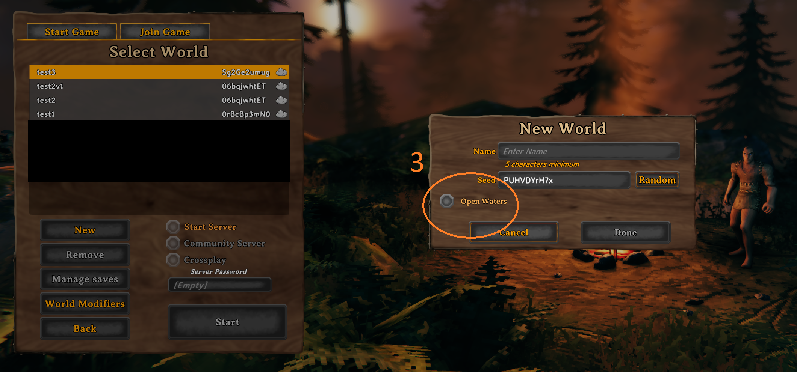 | 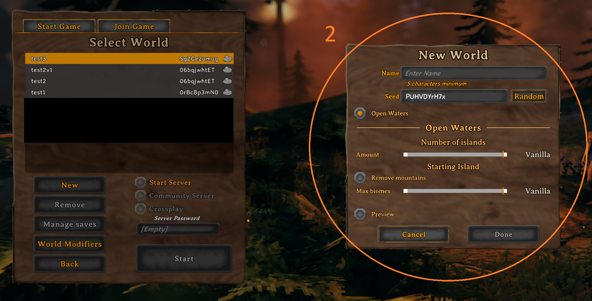 | 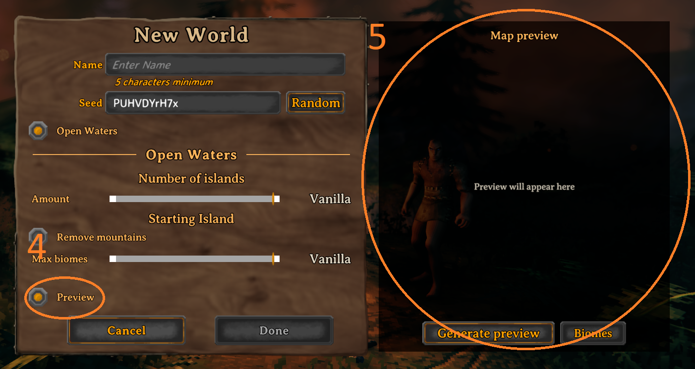 |
| Panel collapsed; generation is vanilla. | Island and starting-island controls are shown. | Preview window is open but empty. |

### General

| Control | What it does |
| --- | --- |
| **Open Waters** | Master switch. Off = vanilla world generation, panel controls hidden. |
| **Number of islands** | `Few`, `Medium` (default: `Vanilla`). Few and Medium replace the terrain noise and calibrate land against vanilla for the same seed. |

`Few` targets about 27% of vanilla land, `Medium` about 50%. These values are relative to the land of the same seed in vanilla, not percentages of the whole map.

Vanilla reference on the same seed:

| Land view | Biome view |
| --- | --- |
| 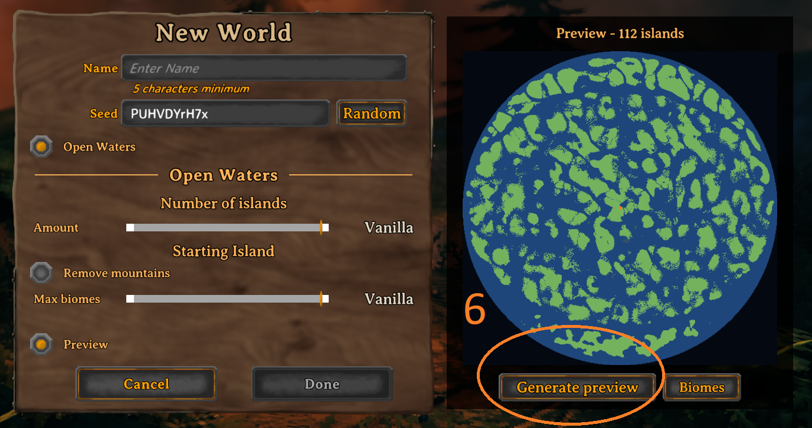 |  |
| Vanilla land/water preview. | Vanilla biome colours. |

### Starting Island

These options affect only the starting island; the rest of the world uses the selected island preset unchanged.

| Control | What it does |
| --- | --- |
| **Remove mountains** | Suppresses high peaks on the starting island. Off by default. |
| **Max biomes** | Limits which biomes can appear on the starting island: `1`, `2` or `Vanilla` (no changes). |

Examples on the same seed with the **Few** preset:

| Max biomes: Vanilla | Remove mountains on |
| --- | --- |
| 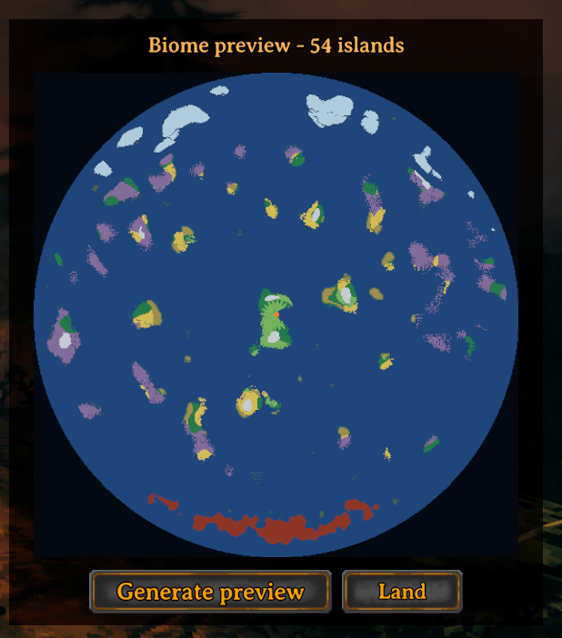 | 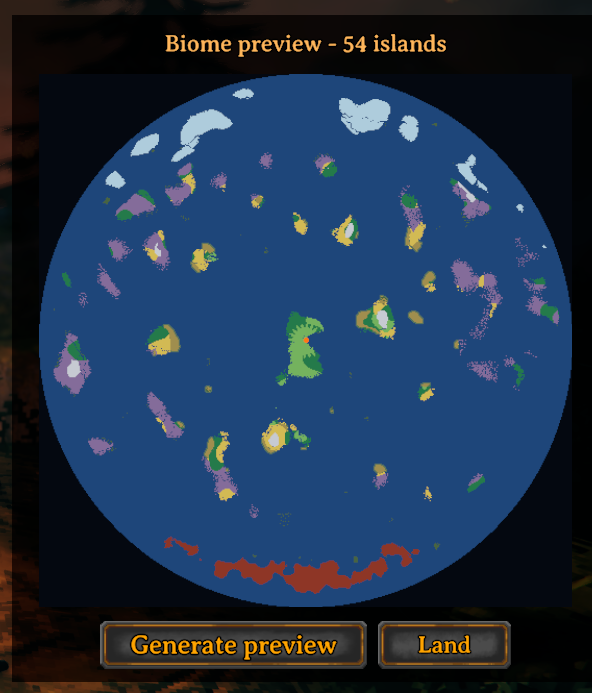 |
| Starting island keeps its vanilla biomes. | High peaks on the starting island are suppressed. |

| Max biomes: 1 | Max biomes: 1, mountains kept |
| --- | --- |
| 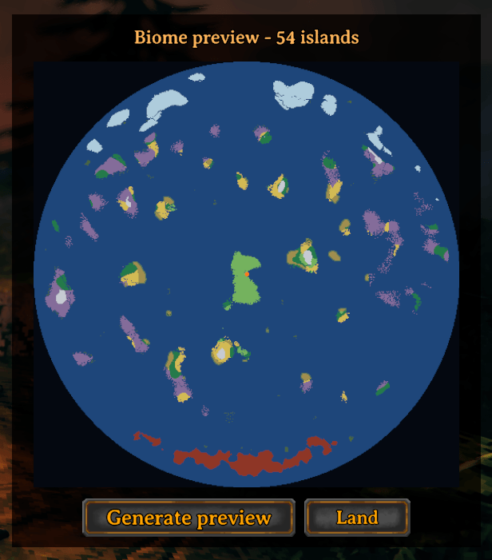 | 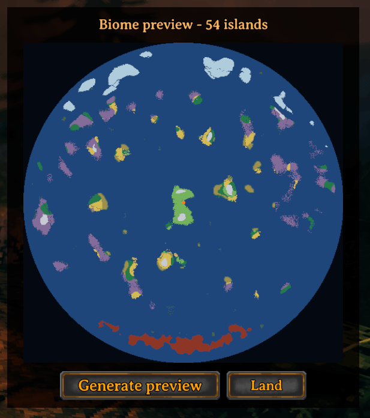 |
| All counted starting-island biomes become Meadows. | Biome limit is applied, but mountain peaks remain. |

### Preview

| Control | What it does |
| --- | --- |
| **Preview** | Shows the map preview window. |
| **Generate preview** | Renders a map of the current seed and settings. |
| **Land / Biomes** | Switches the preview between land/water and biome colours. |

## Starting-island options

Both options below apply **only** to the island containing the spawn point. They do not change other islands, which use the selected island preset.

### Remove mountains

Peaks above `0.34` on the starting island are compressed and capped at `0.39`, which is below the game's mountain threshold. Off by default because it changes the look of the start area.

### Max biomes

- `1`: the counted starting-island biomes become **Meadows only**.
- `2`: the starting island gets **two biomes - Meadows and BlackForest**. Native Meadows/BlackForest are kept; a 250 m safe radius around spawn is always Meadows; other counted land biomes (Plains, Mistlands, Swamp, etc.) are randomly mapped to Meadows or BlackForest.
- `Vanilla`: no changes.

Mountains do **not count** toward the biome limit. They disappear only through `Remove mountains`, which works on the terrain height itself.

## Preview

The preview uses a temporary world generator for the entered seed and renders 512x512 samples into a 400x400 map. Rendering is split across frames, but initial generator setup and island analysis can still freeze the game briefly. Up to eight previews are cached in memory.

The preview and the generated world use the same code. If the generator is cached and you change `Max biomes` or `Remove mountains`, the cache is invalidated and rebuilt, which can take a few seconds. A preview that fails shows "Preview failed - see log"; check `BepInEx/LogOutput.log`.

Biome colours: Meadows green, BlackForest dark green, Swamp olive, Mountain light grey, Plains yellow, Mistlands purple, AshLands red, Deep North pale blue. Swamp water is drawn with a separate muted colour. The orange marker is the spawn point.

Medium preset on the same seed:

| Land view | Biome view |
| --- | --- |
| 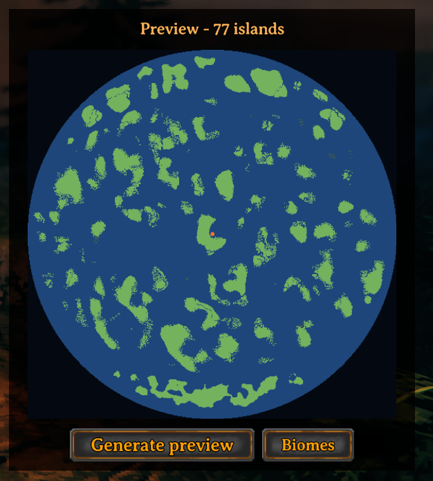 |  |
| Land/water view, `Biomes` button visible. | Biome colours, `Land` button visible. |

Generated **Few** world in game:

| World map | Starting island |
| --- | --- |
| 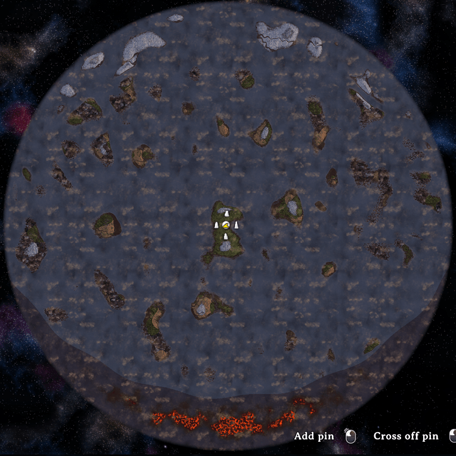 | 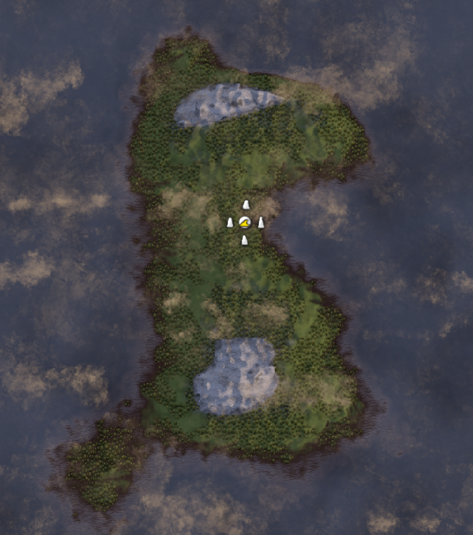 |
| Ocean-heavy world map. | Close-up of the starting island. |

## Settings per world

When you create a world, the current settings are saved in a plain-text file called `OpenWaters.worldSettings`, next to the world's save. For a local world, the path is:

`%USERPROFILE%\AppData\LocalLow\IronGate\Valheim\worlds_local\<world name>\OpenWaters.worldSettings`

This is where the world's local files (`.db`, `.fwl`, map caches) live. Local worlds keep the settings file here, in `worlds_local\<world>\`. Steam Cloud worlds keep it alongside their own save in `worlds\<world>\`, so it travels with the world. If cloud storage is unavailable or full, the settings file is written locally and a warning is logged.

If Valheim was started with a custom `-savedir`, use that save root instead of `%USERPROFILE%\AppData\LocalLow\IronGate\Valheim`. The file is read automatically when the world is loaded later - the New World form is not needed again. If no settings file with the matching world UID is found, generation falls back to Vanilla. When joining a hosted world the client uses the settings received from the host and ignores its local settings file; see [Hosted worlds](#hosted-worlds).

The settings file stores the complete generation snapshot: preset, world radius, general biome limit, starting-island biome limit, the `Remove mountains` flag, the effective tuning values from `valheim.openwaters.cfg` (after clamping), plus `generatorVersion`, `modVersion`, the seed and the vanilla world `uid`. Changing the config later does not change an existing world.

If a settings file exists but is malformed or was written by an incompatible `generatorVersion`, the world load is **blocked** with a popup instead of silently generating different terrain. A world with no settings file, or a settings file without a UID, is treated as vanilla.

### Updating a settings file from an older alpha

Settings files created before 0.2.1 have no `uid` line, so Open Waters ignores them and the world loads with vanilla terrain. To keep using the old settings:

1. Load the world once.
2. Open `BepInEx/LogOutput.log` and find the line `[Settings] World '<world name>' uid=<id>.`
3. Open the world's `OpenWaters.worldSettings` and add `uid=<id>` on a new line.
4. Load the world again. Open Waters matches the file and uses its settings.

Steam Cloud worlds may still have the old file in `worlds_local`. Once you add the UID, Open Waters copies it to the cloud save automatically.

If the file uses an unsupported `generatorVersion`, it cannot be updated this way; create a new world instead.

## Hosted worlds

Open Waters synchronizes generation settings between the host and the clients. Normally, you do not need to copy the settings file or match config files by hand.

1. Install the same Open Waters version on the host and on every client.
2. Create the world on the host and set its options on the New World screen. The settings file is written next to the world's own save, cloud or local.
3. Join the hosted world. During the handshake the host sends the world's generation settings to each client, and every client generates the same terrain.
4. The in-game panel cannot change settings on an existing world; create a new world to change its preset.

**Clients without Open Waters** cannot join a hosted world that uses custom settings. The host rejects them before they generate any terrain; they see the game's "wrong version" connection error.

**Clients with Open Waters** receive a specific in-game message and are disconnected when the host's settings are invalid or its generator version is unsupported. A client with the mod joining a vanilla host simply plays a vanilla world and ignores its own local settings file unless `LocalSidecarFallback` is enabled.

If the host's settings are not received, enable `LocalSidecarFallback` in `valheim.openwaters.cfg` and copy the host's `OpenWaters.worldSettings` into the matching world folder on the client (`worlds_local` or `worlds`). The client matches the file by the world UID from the vanilla handshake, not by seed.

Setting `Enabled = false` in `valheim.openwaters.cfg` keeps that client fully vanilla: it does not advertise the mod and does not apply server settings. Such a client cannot join a hosted world that requires Open Waters.

Dedicated-server support is not included in this release.

## Advanced configuration

The config file is created at:

`<VALHEIM_DIR>\BepInEx\config\valheim.openwaters.cfg`

In an r2modman/Thunderstore profile, look in that profile's `BepInEx\config` folder. The file is only created after the game has started once with the mod installed.

| Section | Key | Default |
| --- | --- | --- |
| General | `Enabled` | `true` |
| General | `DebugSelfTest` | `false` |
| General | `LocalSidecarFallback` | `false` |
| Few | `LandFraction` | `0.27` |
| Few | `FrequencyScale` | `0.60` |
| Few | `PeakProtection` | `0.20` |
| Few | `DetailDamping` | `0.35` |
| Few | `MountainCompressionStart` / `MountainCompressionFactor` | `0.34` / `0.55` |
| Medium | `LandFraction` | `0.50` |
| Medium | `FrequencyScale` | `0.70` |
| Medium | `PeakProtection` | `0.60` |
| Medium | `DetailDamping` | `0.35` |

Lower `FrequencyScale` makes larger islands. Higher `PeakProtection` keeps more mountains. `LandFraction` is relative to vanilla land for the same seed.

`DebugSelfTest` is a diagnostic switch: with it enabled, the mod runs a short set of world-settings checks at startup and writes `PASS`/`FAIL` lines to `BepInEx/LogOutput.log`. Leave it off for normal play.

`LocalSidecarFallback` lets the client use a manually copied settings file when the host does not provide compatible settings. Leave it off for normal play: on a vanilla host, a local settings file can change the terrain and desync the client.

## Known limitations (alpha)

- **Settings-file matching uses the world UID.** When joining a hosted world the client uses the settings received from the host. If those settings are unavailable, a manually copied settings file is matched by the world UID when `LocalSidecarFallback` is enabled. There is no seed fallback.
- **Settings files from older alpha builds (before 0.2.1) need a UID.** See [Updating a settings file from an older alpha](#updating-a-settings-file-from-an-older-alpha). Without a UID, the file is ignored and the world generates vanilla terrain.
- **Only the starting island has biome limits.** The general per-island biome limit is stored but not applied yet.
- **Terrain calibration is not cached on disk.**
- **Preview generation can freeze the game.** Windows may report that the application is not responding. Click **Wait**; in most cases the preview finishes successfully.
- **Starting-island detection is not perfect**, especially on Vanilla worlds with many islands close together. Nearby islands can be modified by mistake. Parts of the starting island cut off by rivers become separate islands and are not modified. `Remove mountains` can also change river placement and therefore the starting island's shape, which can cause differences between the preview and the generated world.
- **Boss and location placement changes with fewer islands.** The number and distribution of generated locations, including boss altars, can change. Testing confirmed that boss locations can spawn, but 100% reliability cannot be guaranteed on every seed.
- **Mountain locations can be missing with the Few preset.** Compressed peaks may not reach the height caves need, so some mountain locations, including caves, may not spawn. A fix is planned.
- **The game is harder and slower with fewer islands.** Fewer islands mean fewer resources and longer journeys. With `Max biomes: 1`, reaching a Black Forest may require building a raft, and finding boars to tame can be harder on a small starting island.

## Reporting a problem

Include all of the following:

- the **seed** and world name,
- preset and starting-island settings,
- what you expected and what you got,
- a screenshot or map excerpt,
- `BepInEx/LogOutput.log` (and `%LOCALAPPDATA%/IronGate/Valheim/Player.log` if the game crashed).

The generator log line `[Gen] Generator state: ...` contains the seed, world version, noise offsets and river counts - it makes reports reproducible.
