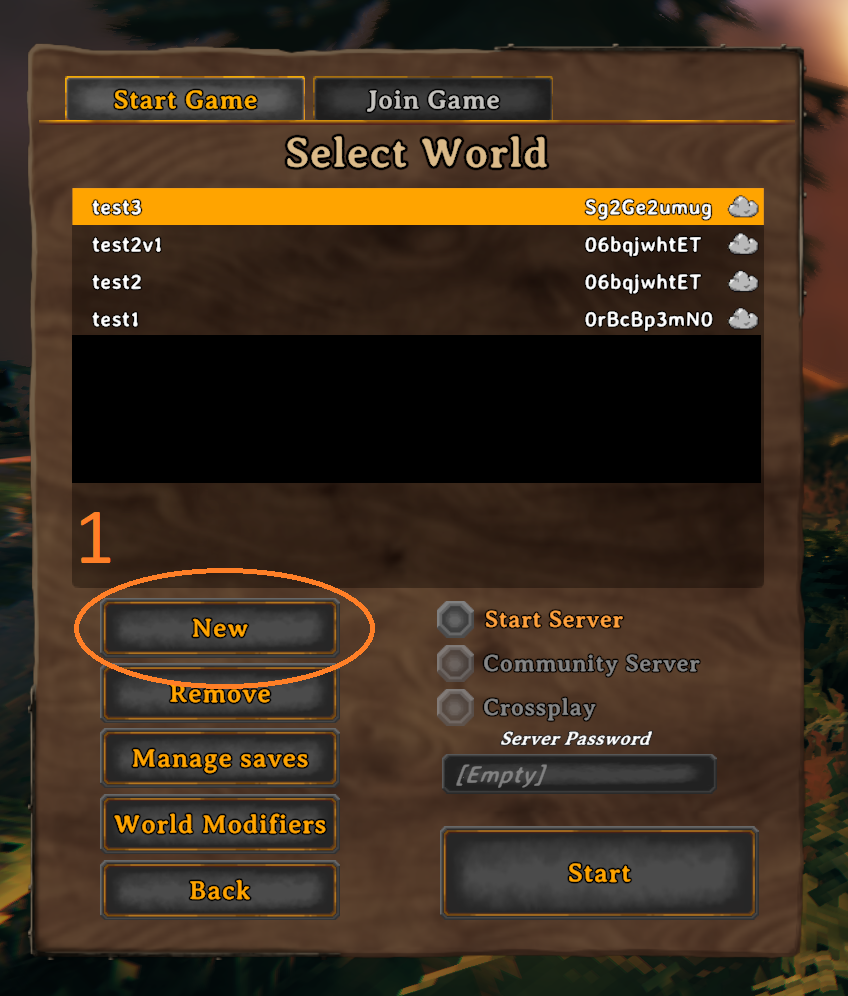
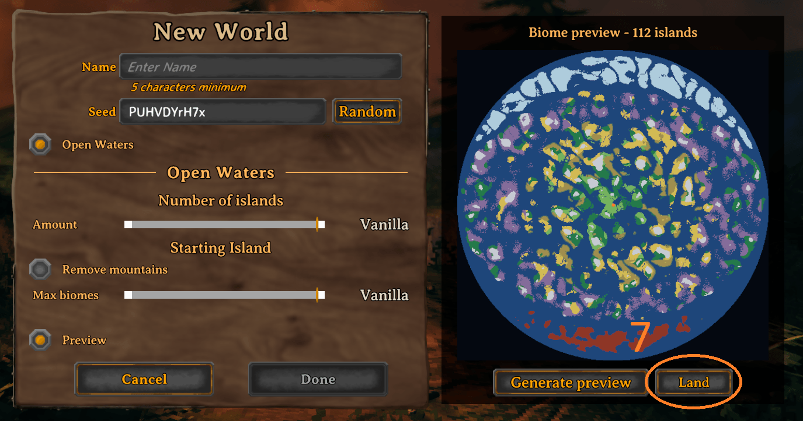
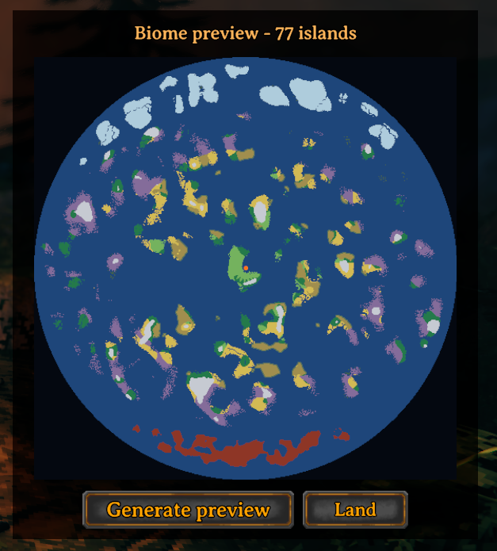

# Open Waters - User Guide

Open Waters is an alpha (0.1.2) world-generation mod for Valheim 1.0.21. It gives you fewer islands and more open ocean, while keeping normal Valheim coastlines. It is currently intended for **single-player**. Multiplayer is not officially supported; [manual synchronization](#manual-synchronization-experimental-unsupported) is an experimental, unsupported workaround.

## Requirements

- Valheim 1.0.21 - this is the version the mod is tested on; older versions may work but are not verified
- BepInEx 5.4.x (BepInExPack Valheim)
- The mod installed on the client (server and client sync is not implemented yet)

## Installation

1. Install BepInExPack Valheim if you have not already.
2. Copy `OpenWaters.dll` into `<VALHEIM_DIR>/BepInEx/plugins/OpenWaters/`.
3. Start the game and create a new world from the New World screen.

For local builds, import the release ZIP through r2modman: **Settings -> Profile -> Import local mod**. A Thunderstore release is planned; once published, the mod can also be installed through r2modman or the Thunderstore Mod Manager.

The plugin writes `BepInEx/config/valheim.openwaters.cfg` on first start. Advanced tuning lives there; the in-game panel is enough for normal use.

## The New World panel

The Open Waters section is added below the seed field. All controls apply to the **next world you create** - they cannot be edited on an existing world.

  

*Select **New** to open the Open Waters panel.*

| Open Waters off | Open Waters on | Preview enabled |
| --- | --- | --- |
|  |  |  |
| Panel collapsed; generation is vanilla. | Island and starting-island controls are shown. | Preview window is open but empty. |

### General

| Control | What it does |
| --- | --- |
| **Open Waters** | Master switch. Off = vanilla world generation, panel controls hidden. |
| **Number of islands** | `Few`, `Medium` (default: `Vanilla`). Few and Medium replace the terrain noise and calibrate land against vanilla for the same seed. |

`Few` targets about 27% of vanilla land, `Medium` about 50%. These values are relative to the land of the same seed in vanilla, not percentages of the whole map.

Vanilla reference on the same seed:

| Land view | Biome view |
| --- | --- |
|  |  |
| Vanilla land/water preview. | Vanilla biome colours. |

### Starting Island

These options affect only the starting island; the rest of the world keeps its terrain and biomes.

| Control | What it does |
| --- | --- |
| **Remove mountains** | Suppresses high peaks on the starting island. Off by default. |
| **Max biomes** | Limits which biomes can appear on the starting island: `1`, `2` or `Vanilla` (no changes). |

Examples on the same seed with the **Few** preset:

| Max biomes: Vanilla | Remove mountains on |
| --- | --- |
|  |  |
| Starting island keeps its vanilla biomes. | High peaks on the starting island are suppressed. |

| Max biomes: 1 | Max biomes: 1, mountains kept |
| --- | --- |
|  |  |
| All counted starting-island biomes become Meadows. | Biome limit is applied, but mountain peaks remain. |

### Preview

| Control | What it does |
| --- | --- |
| **Preview** | Shows the map preview window. |
| **Generate preview** | Renders a map of the current seed and settings. |
| **Land / Biomes** | Switches the preview between land/water and biome colours. |

## Only the starting island is changed

Both options below apply **only** to the island containing the spawn point. All other islands keep their vanilla terrain and biomes.

### Remove mountains

Peaks above `0.34` on the starting island are compressed and capped at `0.39`, which is below the game's mountain threshold. Off by default because it changes the look of the start area.

### Max biomes

- `1`: the counted starting-island biomes become **Meadows only**.
- `2`: the starting island gets **two biomes - Meadows and BlackForest**. Native Meadows/BlackForest are kept; a 250 m safe radius around spawn is always Meadows; other counted land biomes (Plains, Mistlands, Swamp, etc.) are randomly mapped to Meadows or BlackForest.
- `Vanilla`: no changes.

Mountains do **not count** toward the biome limit. They disappear only through `Remove mountains`, which works on the terrain height itself.

## Preview

The preview uses a temporary world generator for the entered seed and renders 512x512 samples into a 400x400 map. Rendering is split across frames, but initial generator setup and island analysis can still freeze the game briefly. Up to eight previews are cached in memory.

The preview and the generated world use the same code. If the generator is cached and you change `Max biomes` or `Remove mountains`, the cache is invalidated and rebuilt, which can take a few seconds. A preview that fails shows "Preview failed - see log"; check `BepInEx/LogOutput.log`.

Biome colours: Meadows green, BlackForest dark green, Swamp olive, Mountain light grey, Plains yellow, Mistlands purple, AshLands red, Deep North pale blue. Swamp water is drawn with a separate muted colour. The orange marker is the spawn point.

Medium preset on the same seed:

| Land view | Biome view |
| --- | --- |
|  |  |
| Land/water view, `Biomes` button visible. | Biome colours, `Land` button visible. |

Generated **Few** world in game:

| World map | Starting island |
| --- | --- |
|  |  |
| Ocean-heavy world map. | Close-up of the starting island. |

## Settings per world

When you create a world, the current settings are saved in a plain-text file called `OpenWaters.worldSettings`, in the **local** folder of that world:

`%USERPROFILE%\AppData\LocalLow\IronGate\Valheim\worlds_local\<world name>\OpenWaters.worldSettings`

This is where the world's local files (`.db`, `.fwl`, map caches) live. The path is the same for local and Steam Cloud worlds - for a cloud world the authoritative save is in Steam Cloud, so the sidecar stays on this machine and does **not** travel with the world. The sidecar is not synchronized with Steam Cloud; use local worlds or copy the file manually. See [Known limitations](#known-limitations-alpha).

If Valheim or a dedicated server was started with a custom `-savedir`, use that save root instead of `%USERPROFILE%\AppData\LocalLow\IronGate\Valheim`. The file is read automatically when the world is loaded later - the New World form is not needed again. If no matching sidecar can be found, generation falls back to Vanilla. When joining a hosted world the client has no world name, so the sidecar is found by seed; see [Known limitations](#known-limitations-alpha).

The sidecar stores the complete generation snapshot: preset, world radius, general biome limit, starting-island biome limit, the `Remove mountains` flag, the effective tuning values from `valheim.openwaters.cfg` (after clamping), plus `generatorVersion`, `modVersion` and the seed. Changing the config later does not change an existing world.

If a sidecar exists but is malformed or was written by an incompatible `generatorVersion`, the world load is **blocked** with a popup instead of silently generating different terrain. A world with no sidecar is treated as vanilla.

## Manual synchronization (experimental, unsupported)

Open Waters does not officially support multiplayer or automatic server-to-client synchronization. If you still want to try it, every player must use **the same mod version and the same settings** before the world is generated on their machine:

1. Install the same Open Waters version everywhere.
2. Make sure the BepInEx config is identical on every machine. The file is:
   `<VALHEIM_DIR>\BepInEx\config\valheim.openwaters.cfg`
   In an r2modman/Thunderstore profile it is inside the profile's `BepInEx\config` folder.
3. Copy the host's `OpenWaters.worldSettings` into the matching local world folder on each client:
   `...\worlds_local\<world name>\OpenWaters.worldSettings`
   The sidecar must match the world seed; for local worlds the world name should match too. When joining a hosted world, the client searches by seed, so duplicate seeds can be ambiguous.
4. Create/load the world only after all clients are configured. The in-game panel cannot change settings on an existing world.

Treat multiplayer as experimental and unsupported until automatic synchronization and dedicated-server support are implemented.

## Advanced configuration

The config file is created at:

`<VALHEIM_DIR>\BepInEx\config\valheim.openwaters.cfg`

In an r2modman/Thunderstore profile, look in that profile's `BepInEx\config` folder. The file is only created after the game has started once with the mod installed.

| Section | Key | Default |
| --- | --- | --- |
| General | `Enabled` | `true` |
| Few | `LandFraction` | `0.27` |
| Few | `FrequencyScale` | `0.60` |
| Few | `PeakProtection` | `0.20` |
| Few | `DetailDamping` | `0.35` |
| Few | `MountainCompressionStart` / `MountainCompressionFactor` | `0.34` / `0.55` |
| Medium | `LandFraction` | `0.50` |
| Medium | `FrequencyScale` | `0.70` |
| Medium | `PeakProtection` | `0.60` |
| Medium | `DetailDamping` | `0.35` |

Lower `FrequencyScale` makes larger islands. Higher `PeakProtection` keeps more mountains. `LandFraction` is relative to vanilla land for the same seed.

## Known limitations (alpha)

- **Single-player recommended.** Settings are local; there is no automatic server-to-client synchronization. [Manual synchronization](#manual-synchronization-experimental-unsupported) is an unsupported workaround; a client without the same settings will generate a different world.
- **Steam Cloud saves are not synchronized.** `OpenWaters.worldSettings` is always written to local storage and is not uploaded with the cloud save, so another machine loading that world from the cloud will generate vanilla terrain. Use local worlds or copy the sidecar manually.
- **Joining a hosted world finds the sidecar by seed.** The client does not receive the world name when joining, so the mod searches local sidecars for a matching seed. If several worlds share the same seed, the wrong settings may be selected. A stable world UID is planned.
- World size is fixed; the radius stored in the sidecar does not resize Valheim's world.
- `BiomeLimit` (general per-island limit) is stored but not applied yet; only the starting island has biome limits.
- No disk cache for terrain calibration.
- **Preview generation can freeze the game.** Windows may report that the application is not responding. Click **Wait**; in most cases the preview finishes successfully.
- **Starting-island detection is not perfect**, especially on Vanilla worlds with many islands close together. Nearby islands can be modified by mistake. Parts of the starting island cut off by rivers become separate islands and are not modified. `Remove mountains` can also change river placement and therefore the starting island's shape, which can cause differences between the preview and the generated world.
- **Boss and location placement changes with fewer islands.** The number and distribution of generated locations, including boss altars, can change. Testing confirmed that boss locations can spawn, but 100% reliability cannot be guaranteed on every seed.
- **The game is harder and slower with fewer islands.** Fewer islands mean fewer resources and longer journeys. With `Max biomes: 1`, reaching a Black Forest may require building a raft.

## Reporting a problem

Include all of the following:

- the **seed** and world name,
- preset and starting-island settings,
- what you expected and what you got,
- a screenshot or map excerpt,
- `BepInEx/LogOutput.log` (and `%LOCALAPPDATA%/IronGate/Valheim/Player.log` if the game crashed).

The generator log line `[Gen] Generator state: ...` contains the seed, world version, noise offsets and river counts - it makes reports reproducible.
